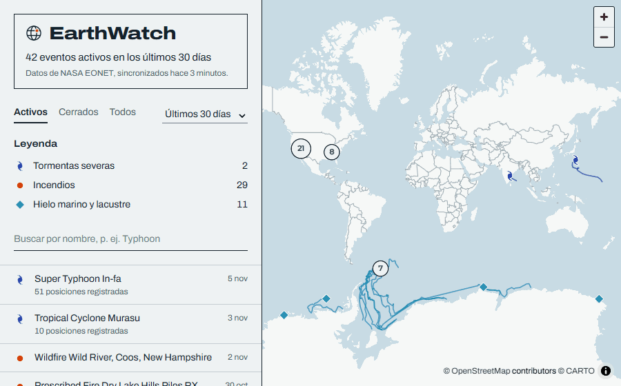
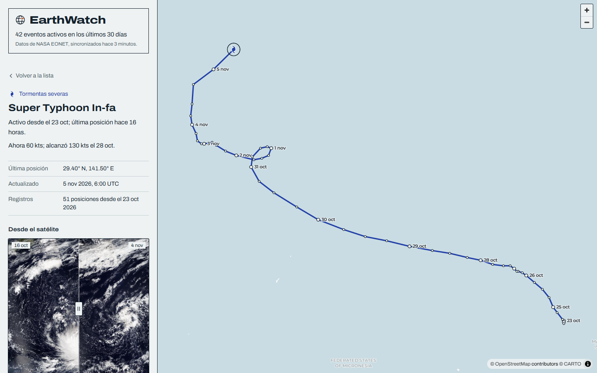
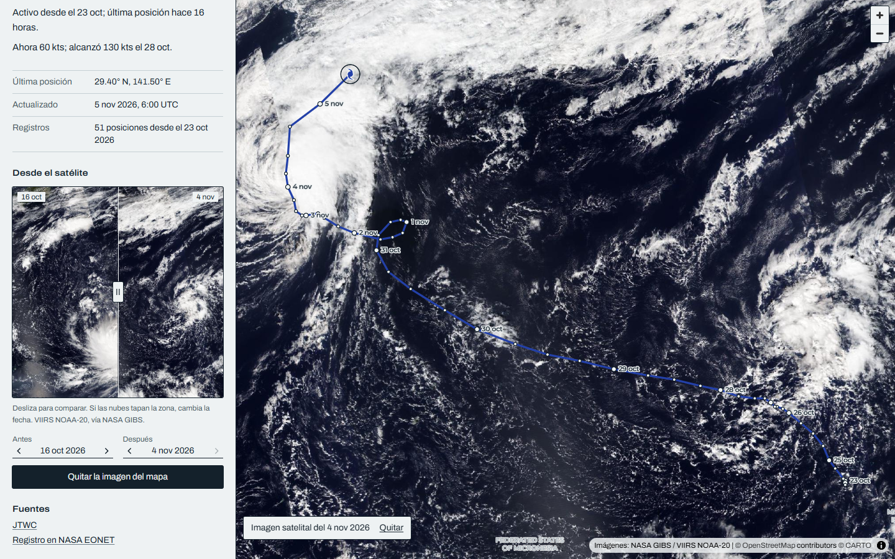
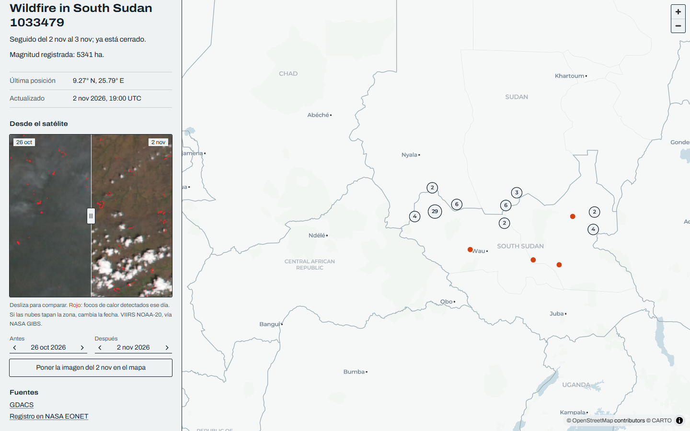
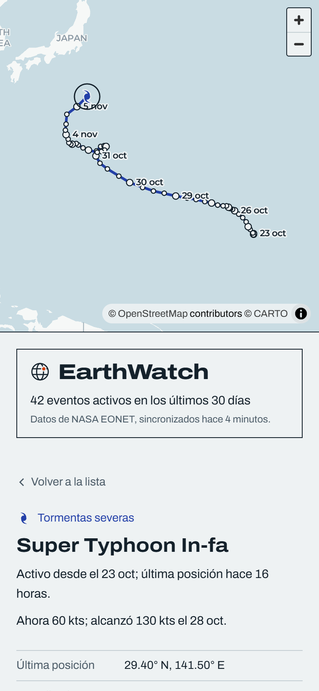
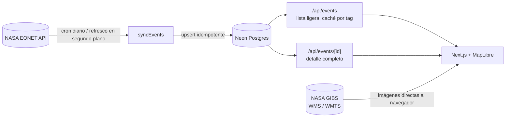

# EarthWatch

Carta interactiva de los eventos naturales que están ocurriendo ahora en el planeta —incendios, tormentas tropicales, volcanes, icebergs a la deriva— con datos de [NASA EONET](https://eonet.gsfc.nasa.gov/) e imágenes satelitales diarias de [NASA GIBS](https://nasa-gibs.github.io/gibs-api-docs/).

**[Ver en vivo → earthwatch-phi.vercel.app](https://earthwatch-phi.vercel.app)**



## Qué se puede hacer

- **Ver qué está pasando ahora**, filtrando por estado (activos, cerrados), periodo (7 a 180 días) y categoría. La leyenda del mapa es el propio filtro.
- **Seguir una tormenta día a día.** Al abrirla, su trayectoria se dibuja con una etiqueta por día, al estilo de las cartas del Centro Nacional de Huracanes, y el panel resume su historia: *«Ahora 60 kts; alcanzó 130 kts el 28 oct.»*
- **Compararla desde el satélite.** Un deslizador enfrenta la imagen de antes y la de después (VIIRS NOAA-20), con flechas para cambiar de día si las nubes tapan la zona. En los incendios se superponen los focos de calor detectados ese día.
- **Llevar la imagen satelital al mapa** completo, bajo la trayectoria.

| Trayectoria con etiquetas por día | Imagen satelital sobre el mapa |
|---|---|
|  |  |

| Incendio con focos de calor | Móvil |
|---|---|
|  |  |

## Arquitectura



- **Los datos se sirven desde mi propia base**, no desde EONET en cada visita. Un cron diario de Vercel y un refresco en segundo plano (cuando los datos tienen más de 30 minutos) mantienen Postgres al día. Si EONET se cae, la app sigue funcionando con la última copia.
- **Dos endpoints con responsabilidades distintas.** `/api/events` devuelve solo lo que pinta el mapa; el detalle de cada evento se pide al abrirlo. Ambos se cachean con `use cache` y se invalidan por tag al terminar cada sincronización.
- **Las imágenes satelitales van directas del navegador a GIBS**, que sirve con CORS abierto: no pasan por el servidor.

## Decisiones técnicas que vale la pena contar

**Respuesta un 73 % más ligera.** La primera versión devolvía cada evento completo: con 180 días eran 3,9 MB, cerca del límite de 4,5 MB de las funciones de Vercel. Separé una lista ligera (posición redondeada a ~100 m, recorrido solo para los 76 eventos que se mueven) del detalle bajo demanda: 1,07 MB.

**Sincronización idempotente con candado atómico.** En producción, dos visitas simultáneas lanzaron dos sincronizaciones a la vez: el candado comprobaba y luego insertaba. Lo sustituí por un índice único parcial en Postgres (`status = 'running'`), de modo que el propio `INSERT` es el candado. Probado lanzando tres sincronizaciones en paralelo: una se ejecuta, dos se omiten.

**Trayectorias que cruzan el antimeridiano.** El huracán Nolo fue de Hawái a Japón, cruzando ±180°. MapLibre unía 179° con −179° dando la vuelta al mundo. Las longitudes se «desenrollan» (`unwrapPath`) para que la línea siga a 181°, 182°…

**Huecos en los datos satelitales.** Suomi-NPP no tenía imagen del 3 de noviembre; NOAA-20 sí. Cambié de satélite y limito la fecha máxima a ayer, porque la pasada del día en curso llega incompleta.

**Dos errores que solo se veían en el navegador.** El CSS de MapLibre (`position: relative`, fuera de capas) ganaba a las utilidades de Tailwind v4 y dejaba el mapa con 0 px de alto; y el worker de MapLibre 6 no se publicaba con el bundle. Por eso las comprobaciones visuales de este proyecto se hacen con capturas reales (Puppeteer + Chrome), no solo con el build.

**Diseño.** La interfaz toma como referencia las cartas meteorológicas impresas: papel frío, tinta azul marino, una tinta por categoría y simbología cartográfica (el símbolo de ciclón tropical, triángulo para volcanes, rombo para hielo). Los mismos trazados SVG se usan en la leyenda y se rasterizan en canvas para el mapa.

## Stack

Next.js 16 (App Router, Cache Components) · React 19 · TypeScript · Tailwind CSS 4 · MapLibre GL 6 · Drizzle ORM · Neon Postgres · Vercel (funciones, cron) · NASA EONET v3 · NASA GIBS

## Ejecutarlo en local

Requisitos: Node 22 o superior.

```bash
npm install
cp .env.example .env.local   # y rellena DATABASE_URL
npm run db:migrate           # crea las tablas
npm run db:sync -- 30        # carga los últimos 30 días de EONET
npm run dev                  # http://localhost:3000
```

Sin `DATABASE_URL` la app también funciona: consulta EONET en vivo en cada petición.

| Script | Qué hace |
|---|---|
| `npm run db:sync -- <días>` | Sincroniza a mano los últimos N días (1–365) |
| `npm run db:generate` | Genera una migración tras cambiar `src/db/schema.ts` |
| `npm run db:migrate` | Aplica las migraciones pendientes |
| `npm run db:studio` | Abre Drizzle Studio para explorar la base |

### Variables de entorno

| Variable | Para qué |
|---|---|
| `DATABASE_URL` | Conexión a Postgres (Neon). Opcional en local. |
| `DATABASE_URL_UNPOOLED` | Conexión directa para las migraciones. Si falta, se usa `DATABASE_URL`. |
| `CRON_SECRET` | Protege `/api/cron/sync`. Vercel la envía automáticamente al cron. |

## Estructura

```
src/
├── app/api/events/            lista ligera  (GET ?status=&days=)
├── app/api/events/[id]/       detalle de un evento
├── app/api/cron/sync/         sincronización diaria
├── components/                Explorer, EventMap, Legend, EventDetail, SatelliteCompare…
├── db/                        esquema Drizzle y conexión
└── lib/
    ├── eonet/                 cliente, normalización, tipos, GeoJSON
    ├── gibs.ts                URLs e imágenes de NASA GIBS
    ├── symbols.ts             simbología cartográfica (SVG → canvas)
    └── sync.ts                EONET → Postgres
drizzle/                       migraciones SQL versionadas
```

## Créditos

- Eventos: [NASA Earth Observatory Natural Event Tracker (EONET)](https://eonet.gsfc.nasa.gov/)
- Imágenes: [NASA Global Imagery Browse Services (GIBS)](https://www.earthdata.nasa.gov/engage/open-data-services-software/earthdata-developer-portal/gibs-api), VIIRS NOAA-20
- Mapa base: © [OpenStreetMap](https://www.openstreetmap.org/copyright) contributors, © [CARTO](https://carto.com/attributions)
